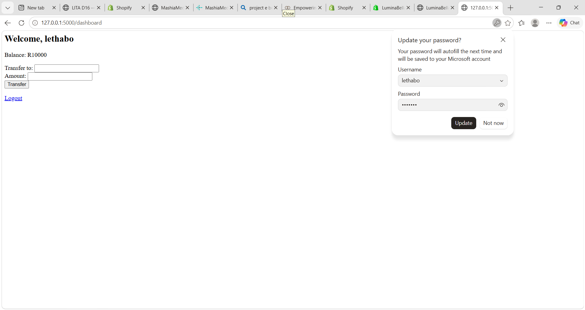
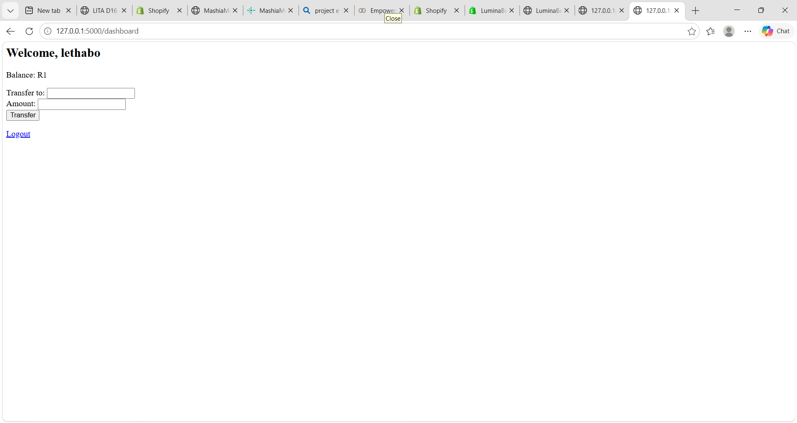
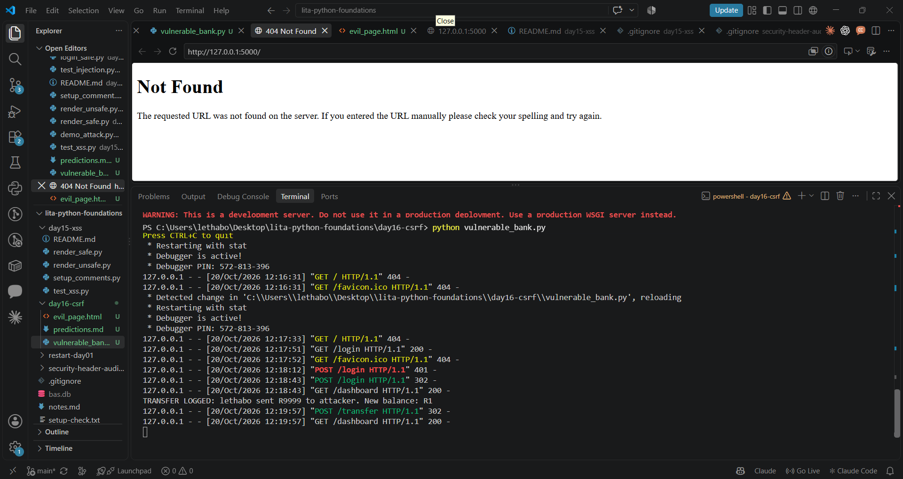
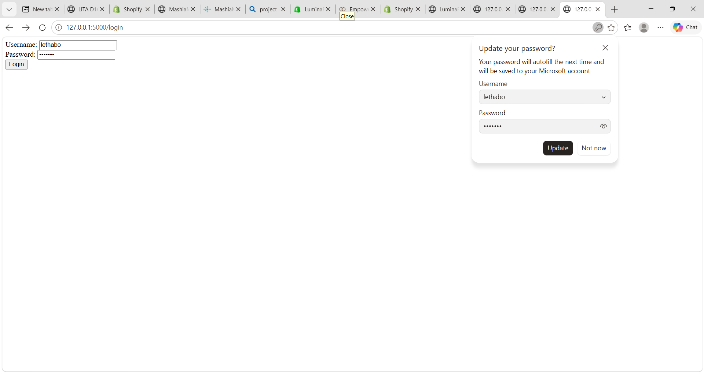
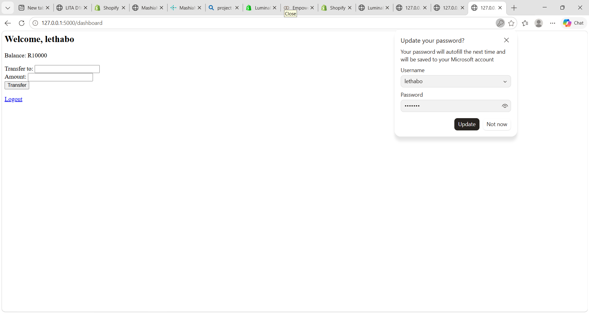
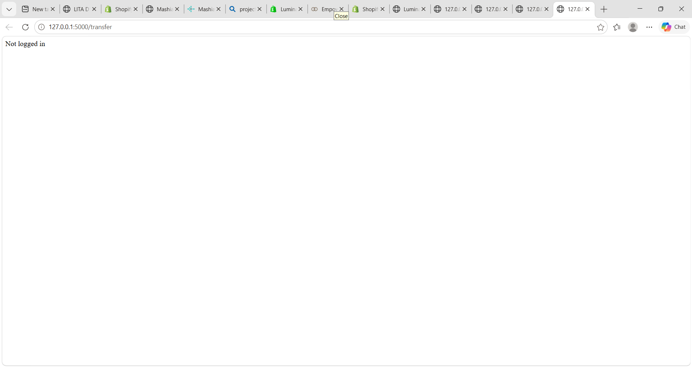
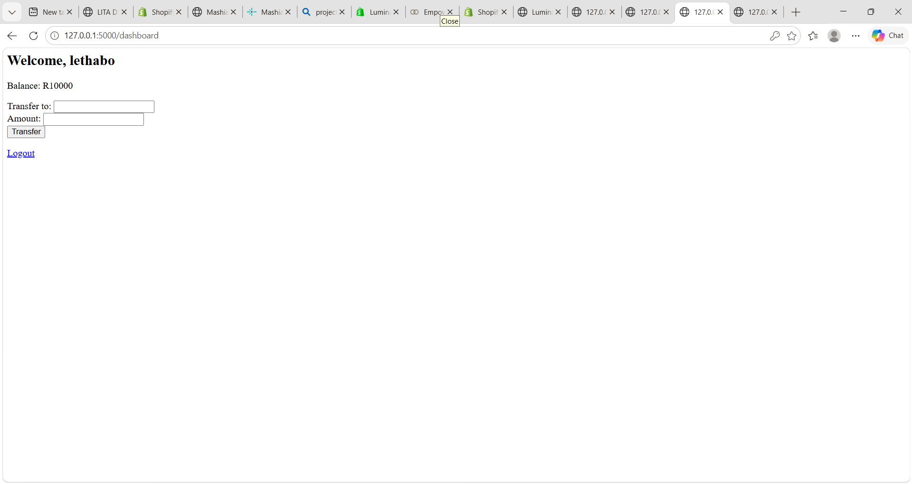
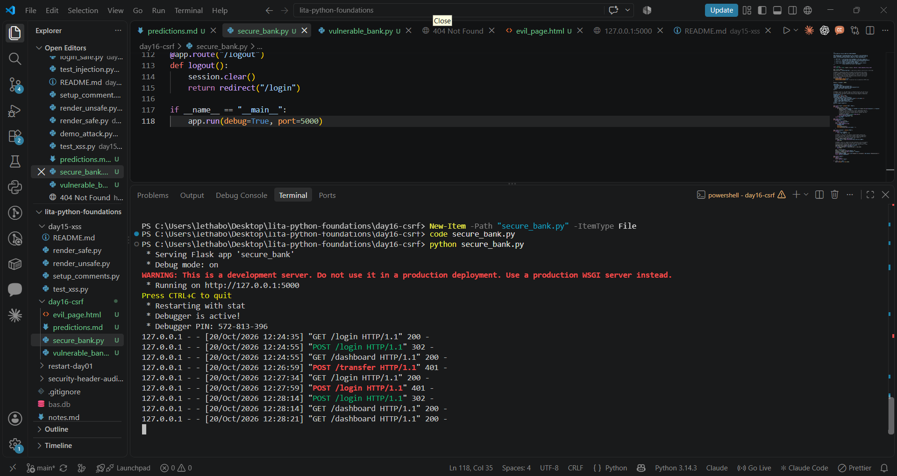

# Day 16 — CSRF Attack & Defence Lab
*A Flask banking application exploited via Cross-Site Request Forgery, then hardened with three independent, layered defences — with full attack/defence evidence captured at each stage.*

## Why CSRF Deserves Serious Attention
CSRF is unusual among web vulnerabilities because it doesn't require breaking anything. The attacker doesn't need to guess a password, inject code, or find a bug in authentication logic. The entire attack rests on a single, otherwise-correct browser behavior: a browser automatically attaches a site's cookies to any request sent to that site's domain, regardless of which page actually *triggered* that request. This is the behavior that makes the web convenient — you don't have to re-authenticate every time you click a link — and it's exactly the same behavior CSRF weaponizes.

The practical consequence: a server can have flawless authentication, no SQL injection, no XSS, and still be fully exploitable, because the vulnerability isn't "the server trusts the wrong credentials" — it's "the server can't distinguish a request the user actually intended from a request their browser was tricked into sending." That distinction is what every defence in this lab is built to restore.

## The Vulnerable Application

`vulnerable_bank.py` is a minimal Flask banking app: login, a dashboard showing balance, and a `/transfer` endpoint that deducts from the logged-in user's balance and logs the transaction. The entire vulnerability lives in one line of logic:

```python
@app.route("/transfer", methods=["POST"])
def transfer():
    if "user" not in session:
        return "Not logged in", 401
    # ...processes the transfer with no further checks
```

This checks that *a* valid session exists, but never checks *where the request came from*. No CSRF token, no `Origin`/`Referer` validation, no `SameSite` restriction on the cookie — the three standard layers of defence are all absent by design, so the exploit below can be observed working cleanly.

## The Attacker Page

`evil_page.html` simulates a page an attacker might get a victim to open via phishing, a malicious ad, or a shortened link shared in a chat. It has no access to the bank's session, no login of its own, and no way to read the victim's cookies directly — it only needs to know the target endpoint URL and the form's field names, both trivially visible in the bank's own page source:

```html
<form id="csrf-form" action="http://127.0.0.1:5000/transfer" method="POST" style="display:none;">
  <input type="hidden" name="recipient" value="attacker">
  <input type="hidden" name="amount" value="9999">
</form>
<script>document.getElementById("csrf-form").submit();</script>
```

The form auto-submits the instant the page loads — no click, no visible interaction required from the victim.

## Executing and Verifying the Attack

**Step 1 — Baseline.** Logged into the bank in one tab. Balance confirmed at R10 000.



**Step 2 — Trigger.** Opened `evil_page.html` as a local file in a second tab — nothing resembling the bank's domain, no click beyond opening the tab. The hidden form submitted itself immediately.

**Step 3 — Observe the damage.** Refreshing the dashboard tab (not the attacker tab — the victim never interacts with `evil_page.html` directly) showed the balance had dropped from R10 000 to R1: a R9999 transfer to a recipient named "attacker," which I never typed, never clicked to confirm, and never saw happen.



**Step 4 — Server-side confirmation.** The Flask development server's console log shows the transfer was processed and logged exactly as any legitimate transfer would be — the server has no way to know this one was forged:
TRANSFER LOGGED: lethabo sent R9999 to attacker. New balance: R1



This three-way proof — balance before, balance after, and server log — rules out the possibility that the balance change was coincidental or caused by something else. The only action taken between steps 1 and 3 was opening an unrelated local HTML file.

## Building the Defence: Three Independent Layers

`secure_bank.py` is the identical application with three defences layered onto `/transfer`. Each one targets a *different* point at which the attack could otherwise succeed, which matters more than it might first appear.

**1. CSRF Token — closes the "the request wasn't initiated through my own interface" gap.**

```python
session["csrf_token"] = secrets.token_hex(32)   # generated at login
# ...embedded in the dashboard form as a hidden field
# ...compared against the session's stored value on every POST to /transfer
submitted_token = request.form.get("csrf_token", "")
if not submitted_token or submitted_token != session.get("csrf_token", ""):
    abort(403)
```

The token is a 256-bit random value, generated server-side at login and known only to that authenticated session. `evil_page.html` has no mechanism to read this value — it would have to know it in advance to forge a valid form, and the only place it's ever rendered is inside the bank's own authenticated dashboard HTML, which the attacker's page never has access to.

**2. `SameSite=Lax` Cookie — closes the gap at the earliest possible point, before authentication is even checked.**

```python
app.config.update(SESSION_COOKIE_SAMESITE="Lax")
```

This instructs the *browser itself* to withhold the cookie on cross-site POST requests. Critically, this defence doesn't depend on anything the server does — it's enforced by the browser before the request even reaches Flask's routing logic. This is also why, during testing, the attack was blocked with a `401 Not logged in` rather than a `403` from the token or Origin checks: the cookie simply never arrived, so the server never even saw an authenticated session to check a token against. That's a *stronger* result than failing at the token stage — it means the request was rejected at the earliest, cheapest possible layer.

**3. Origin Header Check — closes the gap for scenarios where cookie-attribute enforcement might not be reliable.**

```python
origin = request.headers.get("Origin", "")
if origin and not origin.startswith("http://127.0.0.1:5000"):
    abort(403)
```

This validates the request's actual declared network origin against the bank's own domain, independent of cookie behavior entirely. It exists as a backstop for edge cases — older browsers with inconsistent `SameSite` support, or non-browser HTTP clients that don't respect cookie attributes at all but can still be made to set an `Origin` header.

**Why three layers rather than relying on the strongest one alone:** each defence covers a different threat model, and each has a theoretical weakness the others compensate for. A CSRF token alone could, in principle, leak through an unrelated XSS vulnerability elsewhere in the app. `SameSite` alone offers no protection against clients that don't honor the attribute. An Origin check alone can be unreliable against requests crafted outside a standard browser context. Stacking all three means an attacker has to simultaneously defeat three independent mechanisms with three different failure modes — a materially higher bar than any single defence provides on its own, which is the practical meaning of "defence in depth" rather than just a checklist requirement.

## Verifying the Defence — Re-Running the Identical Attack

The test discipline here matters: `evil_page.html` was **not modified in any way** between the vulnerable and secure runs. The only variable that changed was which server was running. This is what makes the before/after comparison a genuine test of the fix rather than a coincidence.

**Step 1 — Fresh baseline.** Logged into `secure_bank.py`, balance confirmed at R10 000 again (a fresh server restart resets the in-memory balance).




**Step 2 — Re-attempt the identical attack.** Opened the same, unmodified `evil_page.html`. This time, instead of a silent success, the request was rejected outright — the page returned "Not logged in," meaning the session cookie never reached the server at all:



**Step 3 — Confirm no damage occurred.** Refreshed the dashboard — balance remained exactly at R10 000, completely untouched:



**Step 4 — Server-side confirmation of the rejection.** The terminal log shows the request was rejected with a `401` status, and — critically — there is **no** `TRANSFER LOGGED` line this time, confirming the transfer logic was never even reached:
127.0.0.1 - - [20/Oct/2026 12:26:59] “POST /transfer HTTP/1.1” 401 -



## What This Confirms, Mechanistically
The "Not logged in" result (rather than a `403 Forbidden` from the token check) is itself informative, not just a pass/fail outcome. It reveals that the `SameSite=Lax` defence was the specific mechanism that stopped this particular attack — the session cookie was withheld by the browser before the request ever reached Flask's session check, let alone the CSRF token or Origin validation. That matters because it demonstrates the layered defences are genuinely independent rather than redundant: had `SameSite` been absent, the attack would have reached the server as an authenticated request, and only the CSRF token (or Origin check, if the token were somehow bypassed) would have been left to stop it. Observing *which* layer caught the attack is direct evidence that each layer is doing real, distinct work — not just restating the same protection three times.

## Reflection
The most transferable lesson from this lab isn't "add a CSRF token" — it's that a server checking "is this request from someone with a valid session" and a server checking "did this specific action genuinely originate from my own interface" are two completely different guarantees, and conflating them is the entire vulnerability. Every defence implemented here is really just a different method of answering that second question from a different angle: a secret only my own form knows, a cookie attribute the browser itself enforces, and a network-level origin check independent of cookies entirely. Once that distinction is clear, CSRF stops looking like an isolated vulnerability class and starts looking like a specific, recognizable instance of a much more general principle: authentication proves *who* is asking, but it never by itself proves that *they* are the one who intended to ask.

---
*Lethabo Mashia · LITA — Day 16 · SE-10 Security Engineering · CSRF*